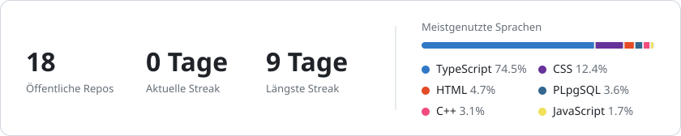
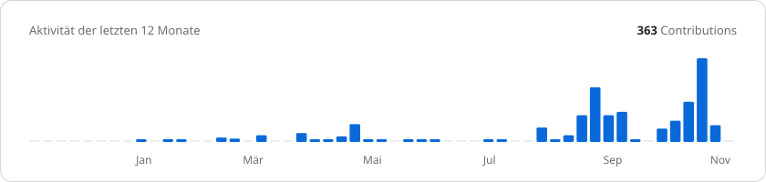

### Etienne Schwab

Ich entwickle Web-Apps vom ersten Entwurf bis zum Deployment, mit einem Auge für ruhiges, durchdachtes Design.

<picture>
  <source media="(prefers-color-scheme: dark)" srcset="https://raw.githubusercontent.com/etschwab/etschwab/output/stats-dark.svg" />
  
</picture>

<picture>
  <source media="(prefers-color-scheme: dark)" srcset="https://raw.githubusercontent.com/etschwab/etschwab/output/activity-dark.svg" />
  
</picture>

#### Projekte

- [**Smartrain**](https://github.com/etschwab/smartrain) · Teamverwaltung für Spieler, Trainings und Spiele · [live ↗](https://smartrain.etienneschwab.ch)
- [**Rankly**](https://github.com/etschwab/ranking) · Tier-List-Rankings für Gruppen, gemeinsam abstimmen und live auswerten · [live ↗](https://rankly-nu.vercel.app)
- [**Portfolio Magazine**](https://github.com/etschwab/bewerben) · Bewerbungsportfolio im Stil einer Sportmagazin-Sonderausgabe · [live ↗](https://bewerben.vercel.app)
- [**CarPin**](https://github.com/etschwab/carpin) · iPhone-Prototyp: Parkplatz speichern, Parktimer, Route zurück zum Auto
- [**Planary Casino**](https://github.com/Fallka0/planary-casino) · Spielgeld-Lobby mit gemeinsamem Wallet und nachprüfbaren Quoten · [live ↗](https://planary-casino.vercel.app)

#### Stack

TypeScript · React · Next.js · Tailwind CSS · Supabase · PostgreSQL · Cloudflare Workers · Vercel · Docker · Claude Code

#### Kontakt

[Portfolio ↗](https://bewerben.vercel.app)
